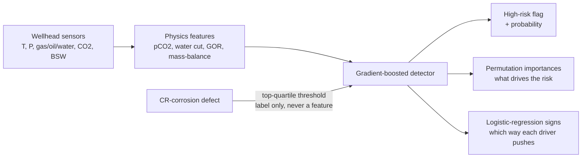

# PipelineGuard

**Explainable wellhead integrity & leak-risk detection, from real process data.**

PipelineGuard flags oil & gas wellheads at high risk of internal corrosion — the slow
failure mode behind most pipeline leaks and loss-of-containment events — from the process
readings a wellhead already reports: temperature, pressure, gas/oil/water rates, CO2
content and basic sediment & water. It is **physics-aware** (its features encode the CO2
corrosion chemistry and the flow physics a reliability engineer reasons about) and
**explainable** (it reports exactly which drivers move the risk, and in which direction),
because in integrity work no inspection crew acts on a black box.

> PipelineGuard is built and validated entirely on **real** wellhead data — the
> `maisaian/oil-gas-leakage` dataset (10,292 wells) — not a synthetic generator. See
> *Results on real wellhead data* below. No private data is used.

[](.github/workflows/ci.yml)
[](pyproject.toml)
[](LICENSE)

---

## Why it exists

A wellhead corrodes from the inside: CO2 dissolves into produced water, forms carbonic
acid, and eats the pipe wall. By the time a leak appears the damage is done. The useful
question is predictive and binary — *given today's process readings, is this well in the
high-risk band that warrants inspection?* PipelineGuard answers it, and — just as
important for a safety-critical domain — it **shows its reasoning**: the features it relies
on are the CO2 partial pressure, the water cut, the operating pressure and the throughput,
the exact quantities a corrosion engineer already watches. An explainable risk flag gets
acted on; a black-box score gets ignored.

## How it works



## Quickstart

```bash
python -m venv .venv && source .venv/bin/activate
pip install -e ".[dev]"

python -m pipelineguard.cli demo        # train, score, and explain on real data
python -m pipelineguard.real_benchmark  # the full anti-overfitting benchmark
pytest                                  # the test suite
```

## The target (and the leakage guard)

The dataset's `CR-corrosion defect` column is the measured internal corrosion rate.
PipelineGuard frames integrity as **detection**: a well is `high_risk` when its corrosion
rate is in the **worst quartile of the fleet** (at or above the 75th percentile, ≈ 0.2328).
That is the inspect / do-not-inspect decision a reliability team actually makes, and it
yields the ROC-AUC / F1 vocabulary that goes with it. The base rate is ~25%, so the
majority baseline ("call everything normal") already scores 75% accuracy — the floor the
detector has to clear.

The corrosion reading is used **only** to build the label. It is never a feature, and no
feature is a transform of it — every input comes from the eight process sensors. So the
quantity that defines the target can never leak into the inputs that predict it. A
shuffled-label control (below) confirms there is no hidden leak: destroy the labels and the
detector collapses to chance.

## The model

A **gradient-boosted classifier** (`HistGradientBoostingClassifier`) on a physics-aware
feature set. A boosted ensemble is the right tool because the corrosion drivers interact
non-linearly (CO2 bites harder when there is a continuous water phase; flow-regime effects
are threshold-like), and on this data the ensemble lifts held-out ROC-AUC from ~0.83 for a
plain logistic regression to ~0.94. It stays explainable through **permutation importance**
(a leakage-resistant, held-out measure of what each feature really buys) and a companion
**logistic regression** whose signed coefficients give the direction of each driver.

### Physics-aware features

| Feature | Formula | Why it matters for corrosion |
|---|---|---|
| CO2 partial pressure | `(CO2 mol% / 100) × pressure` | Carbonic-acid corrosion scales with pCO2 (de Waard–Milliams), not mole % alone |
| Water cut | `BWPD / (BOPD + BWPD)` | Water is the electrolyte; no water phase, little aqueous corrosion |
| Total liquid | `BOPD + BWPD` | Throughput; with water cut, a physical reparametrisation of the oil/water rates |
| Gas-oil ratio | `gas × 1e6 / BOPD` | High GOR shifts flow regime and wall shear → erosion-corrosion |
| Water-balance residual | `BSW/100 − water_cut` | Mass-balance consistency check: two water-fraction estimates that should agree |

Plus the raw sensors that carry orthogonal signal: wellhead temperature (kinetics),
operating pressure (acts through several channels, not only pCO2), gas rate and gas
gravity (gas-phase composition).

## Results on real wellhead data

Run `python -m pipelineguard.real_benchmark`:

```
wells (rows)        : 10292
target              : high_risk = corrosion rate >= 0.2328 (top 25% of the fleet)
base rate / majority: 25.1% high-risk  ->  majority baseline accuracy 75.0%

cross-val (5-fold)  : ROC-AUC 0.9430 +/- 0.0029   F1 0.7702   acc 0.8938
held-out test       : ROC-AUC 0.9441   F1 0.7941   acc 0.9043
train vs held-out   : train AUC 0.9762  held-out AUC 0.9441  (gap 0.0321)
shuffled-label ctrl : held-out AUC 0.4937  (chance ~ 0.5)
regression x-check  : corrosion-rate R2 0.5704 (held-out)

verdict: well-fit: small train/held-out AUC gap and the detector clears the majority baseline comfortably

top feature importances (permutation, drop in held-out ROC-AUC):
   wellhead_press_psi         +0.1922 +/- 0.0122
   total_liquid_bpd           +0.1164 +/- 0.0054
   co2_partial_pressure_psi   +0.1093 +/- 0.0063
   bsw_pct                    +0.0470 +/- 0.0037
   gas_rate_mmcfd             +0.0461 +/- 0.0029
   water_cut                  +0.0453 +/- 0.0042

logistic-regression direction (standardized coef, + raises risk):
   wellhead_press_psi         -1.0732
   total_liquid_bpd           -0.4622
   gas_oil_ratio              +0.3518
   gas_rate_mmcfd             +0.3211
   water_cut                  -0.1577
   co2_partial_pressure_psi   -0.1234
```

**What this says.** The detector reaches **0.944 held-out ROC-AUC** and **90.4% accuracy**
against a 75.0% majority baseline — a genuine lift, on wells it never saw. It is **well-fit,
not overfit**: the train-to-held-out AUC gap is only 0.032, and five-fold cross-validation
(0.943) lands right on the single held-out split (0.944), so this is stable skill, not a
lucky partition. The **shuffled-label control** is the proof there is no leakage: permute
the labels and the same pipeline falls to 0.494 AUC — pure chance. The signal is real, and
it is also present on the continuous corrosion rate (regression R² 0.57), so the
threshold is not manufacturing the result.

**What drives it.** The detector keys on exactly the quantities corrosion engineering
cares about: operating pressure, liquid throughput, the **CO2 partial pressure**, and the
water phase (BSW and water cut). The physics-derived CO2 partial pressure is the third
strongest driver on held-out data — the sweet-corrosion mechanism showing up directly in a
model that was never told the chemistry. The logistic-regression signs give the engineer a
readable sanity check on the direction of each driver. This is a capability a reliability
team can put in front of an inspection planner and defend line by line.

## Project layout

```
pipelineguard/
  real_data.py       load/fetch the real wellhead data + derive the integrity target
  features.py        the physics-aware derived features (pCO2, water cut, GOR, mass balance)
  model.py           the explainable detector (GBM) + metrics + importances + LR direction
  real_benchmark.py  CV + held-out + baseline + shuffle control + verdict + explainability
  cli.py             the `demo`
datasets/
  wellhead_integrity_real.csv   the vendored real data (see datasets/README.md)
docs/estudio/        deep Spanish study guide
```

## Testing and quality

* **26 tests** cover the loader and target derivation, the physics features (one pinned by
  hand), the detector beating the baseline on held-out data, the feature importances and
  signed coefficients, the full benchmark (well-fit, cross-val/held-out agreement, the
  shuffled-label collapse, the regression cross-check), the fetch path via a monkeypatched
  network, and the CLI. CI requires at least 85% coverage.
* `ruff` for lint; `bandit` and `gitleaks` for security.

See the Spanish study guide in [`docs/estudio/`](docs/estudio/) for the corrosion physics,
the feature formulas, the metrics, and the over/underfitting analysis with these real
numbers.

## License

[MIT](LICENSE) © Angelo David Padilla Romero
